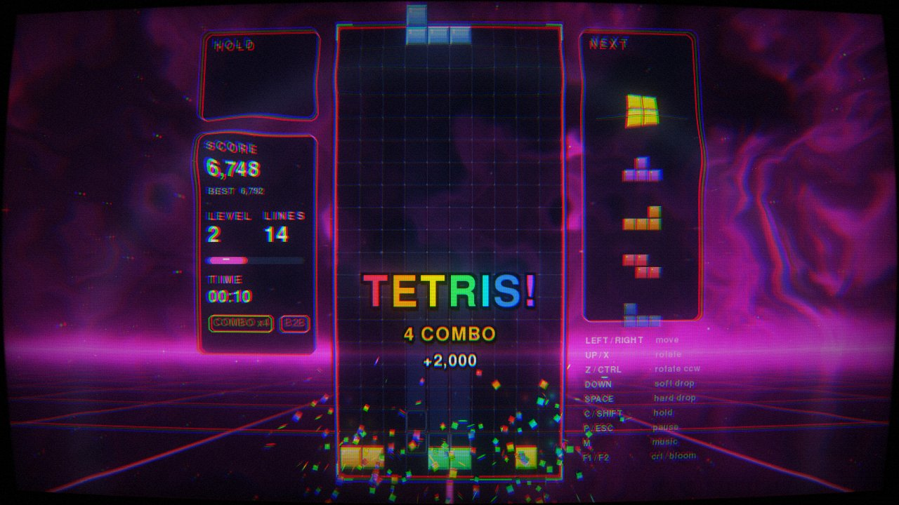
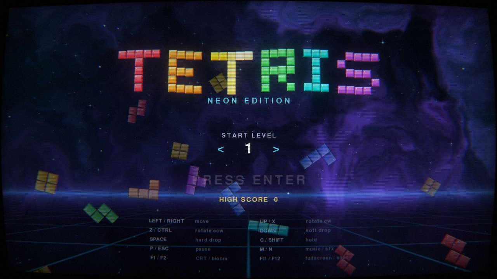
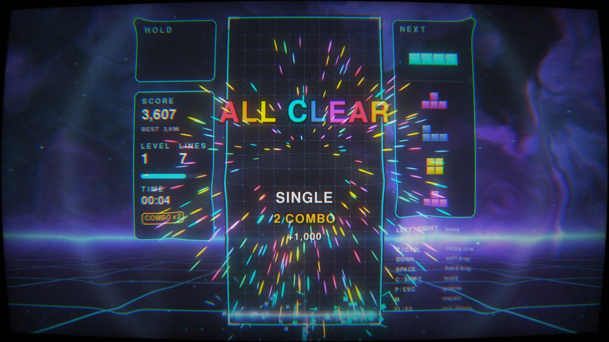

# Neon Tetris

A Tetris game in Python with lots of animation and real GLSL shaders.
It uses pygame for the window and input, moderngl for OpenGL 3.3, and numpy
for particles and synthesized audio. There are no asset files: every sprite,
sound effect and the music are generated when the game starts.



| Title screen | All clear |
|---|---|
|  |  |

## Run it

```bash
cd tetris
pip install -r requirements.txt
python main.py
```

Options: `--no-shaders` (software renderer), `--mute`, `--fullscreen`.
If OpenGL 3.3 isn't available, the game switches to the software renderer on its own.

## Controls

| Key | Action |
|---|---|
| Left / Right (A / D) | move |
| Up / X / W | rotate clockwise |
| Z / Ctrl | rotate counter-clockwise |
| Down (S) | soft drop |
| Space | hard drop |
| C / Shift | hold |
| P / Esc | pause (Q in pause = back to title) |
| M / N | toggle music / sound effects |
| F1 / F2 / F3 | toggle CRT / bloom / FPS counter |
| F11 / F12 | fullscreen / screenshot |

On the title screen, Left and Right choose the starting level (1–15).

## What's in it

**Shaders** (`neon_tetris/shaders.py`)
- Animated background: domain-warped fbm nebula, a 3-layer parallax star
  field with twinkle and flares, and a scrolling synthwave grid. It pulses on
  line clears and changes palette every level.
- HDR bloom: soft-knee bright pass, then a three-level gaussian blur pyramid.
- GPU instanced particles: glows, velocity-stretched sparks, spinning block
  shards, light beams, drop trails and rings.
- Final post-process: CRT curvature, scanlines and aperture mask, vignette,
  up to 4 simultaneous shockwave distortions, trauma-based screen shake (with
  rotation), chromatic aberration, glitch slicing, a red "danger" pulse when
  the stack is high, pause desaturation, pixelated scene transitions and film
  grain.

**Animation** (`neon_tetris/render.py`)
- Pieces glide between cells and animate their rotations (wall kicks included).
- Pulsing ghost piece with a light beam, and a lock-delay flicker.
- Hard drops leave light trails, spray sparks, and jolt the board on a spring.
- Line clears flash white and burst into shards from the center of the row
  outward. The rows above then fall with a small bounce.
- Pop-up text (SINGLE … TETRIS!, T-SPIN, BACK-TO-BACK, COMBO, ALL CLEAR),
  a rolling score counter, and slide/pop animations on the next queue and hold box.
- A level-up banner sweep with spark fountains and a palette change.
- 3-2-1-GO countdown. On game over, the stack turns gray row by row, then
  crumbles apart with physics.
- Title screen: the logo assembles from flying blocks, tetrominoes rain in
  the background, and a shimmer sweeps across the logo.

**Game rules** (`neon_tetris/game.py`): SRS rotation with wall kicks,
7-bag randomizer, hold, 5-piece preview, lock delay with a 15-move reset cap,
DAS/ARR, and guideline scoring: T-spins (full and mini), back-to-back,
combos, all-clear bonuses, and soft/hard drop points. The high score is saved
to `~/.neon_tetris.json`.

**Audio** (`neon_tetris/audio.py`): every sound effect is synthesized with
numpy, plus a chiptune arrangement of Korobeiniki (the classic Tetris theme,
a public-domain folk song) with lead, bass and drums.
